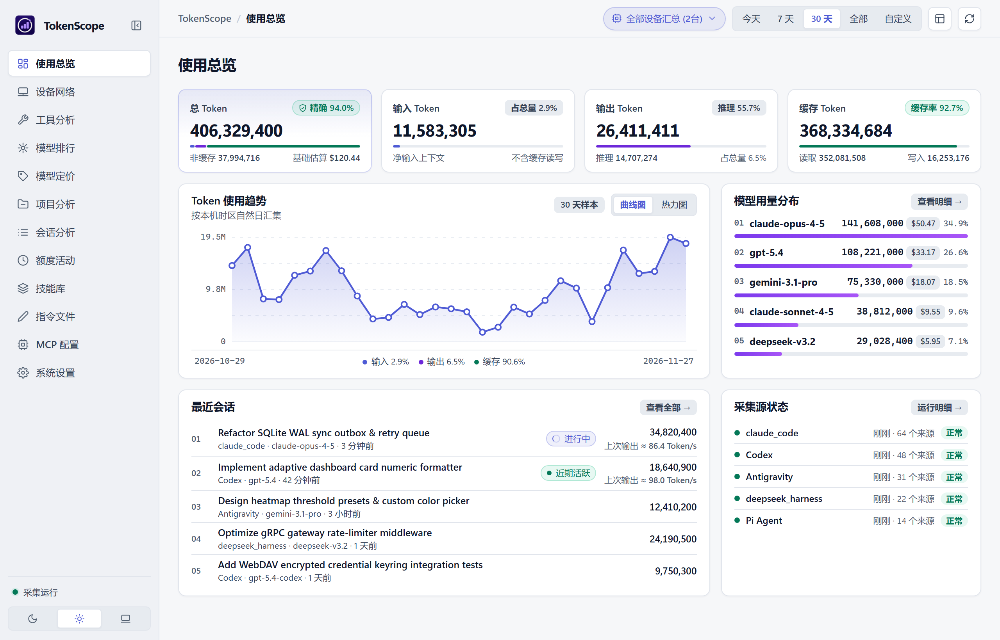
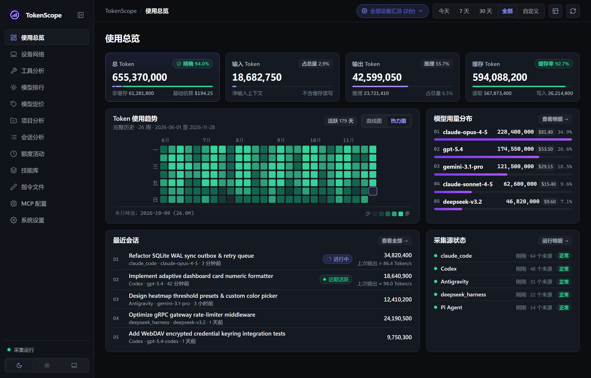
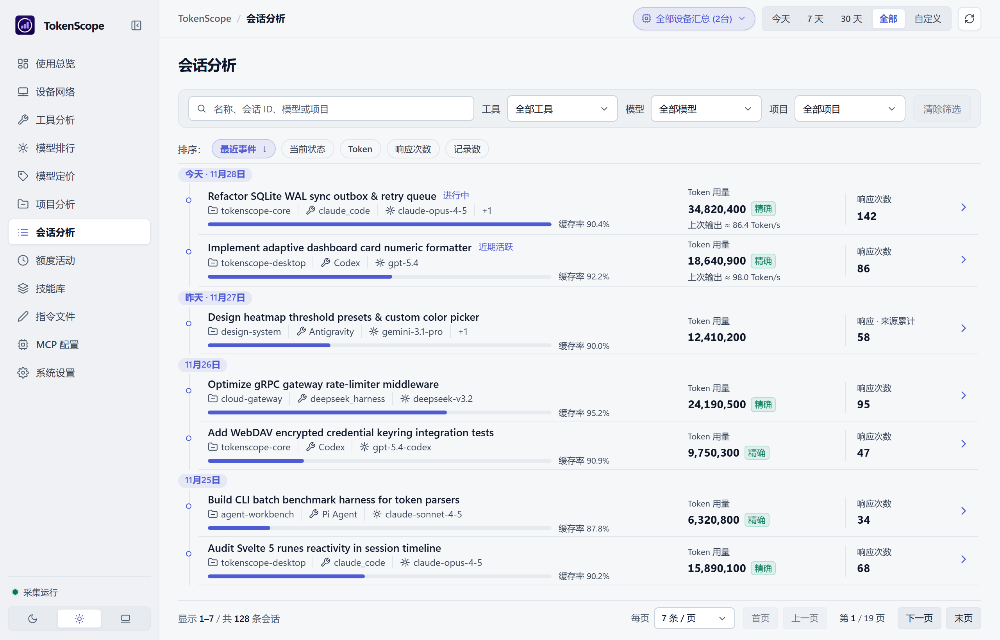
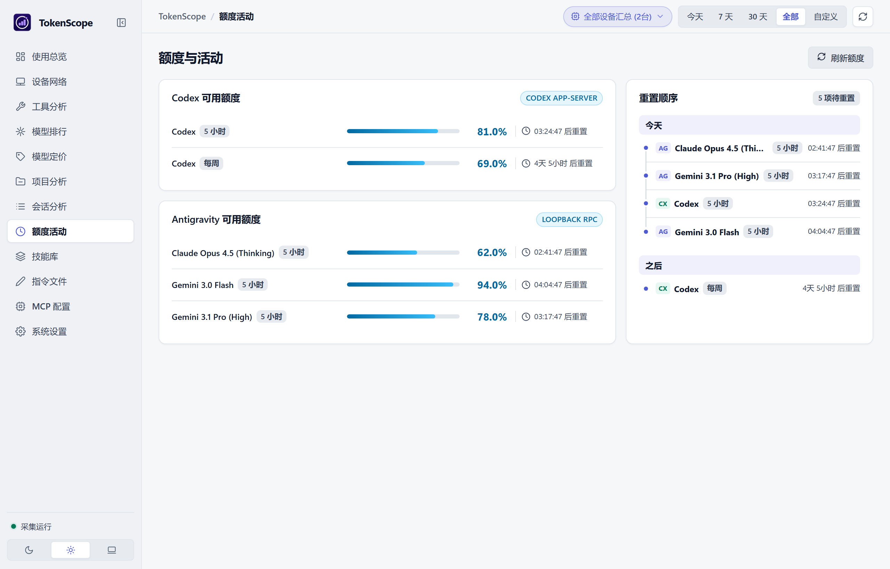
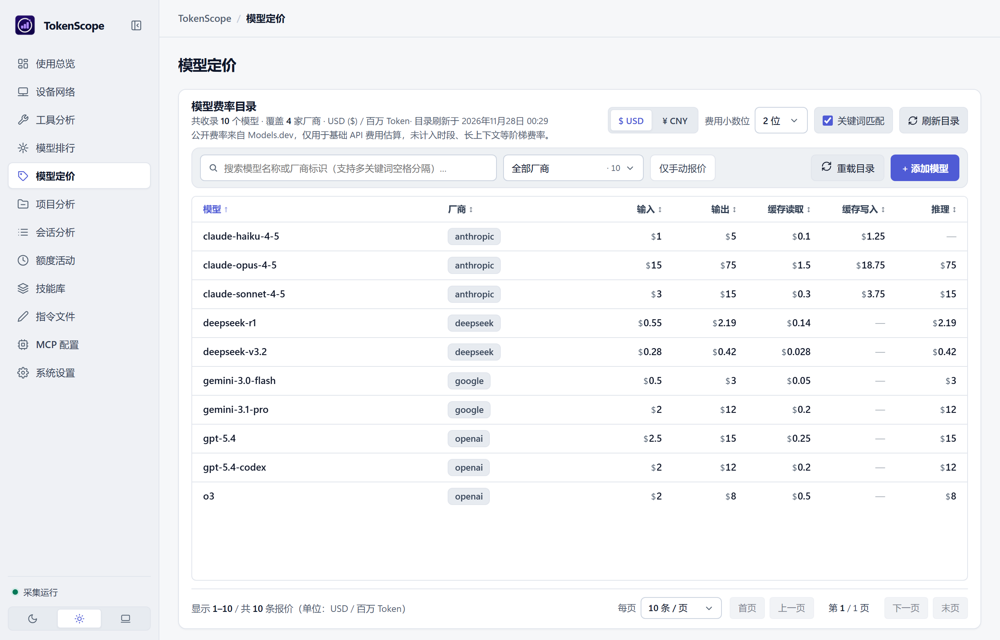

<div align="center">


# TokenScope

**本地优先、低内存的跨设备 AI Token 用量监控与成本分析桌面端**

支持 **Claude Code** · **Codex** · **Antigravity** · **DeepSeek Harness** · **Pi Agent**

[](https://github.com/JinSheng-oam/TokenScope/releases)
[](LICENSE)
[](#技术栈与架构)
[](#下载与平台支持)
[](#下载与平台支持)

[下载安装](#下载与平台支持) · [核心优势](#核心优势) · [界面预览](#界面预览) · [多设备同步](#多设备同步) · [开发与构建](#从源码构建)

</div>

---

> 以下界面截图均使用**模拟测试数据**生成，不含任何真实个人项目或会话信息。

<p align="center">
  
</p>

## 核心优势

| 能力 | 说明 |
| :--- | :--- |
| **多工具一站式无感采集** | 原生支持 **Claude Code、Codex、Antigravity、DeepSeek Harness、Pi Agent**。独立 Rust Agent 后台增量解析本地日志与状态，**无需配置 API 代理、不劫持请求**。 |
| **本地优先 & 隐私红线** | 所有数据持久化在本机 SQLite（WAL 模式）；**绝不读取或上传 Prompt、源代码、模型回复、Cookie 或账号明文**；同步密钥全程托管于系统原生 Keyring。 |
| **极致轻量与低内存常驻** | 基于 **Tauri 2 + Rust + Svelte 5** 构建。支持开机 `--background` 静默采集（不创建 WebView），关闭窗口即释放前端内存，仅保留系统托盘与轻量 Agent。 |
| **多维用量与缓存/成本精算** | 按 **日期、设备、工具、模型、项目、会话** 六维透视；区分精确 / 聚合计量，直观呈现输入/输出、缓存命中率与推理 Token；内置 Models.dev 公开费率与离线兜底目录，支持美元 / 人民币切换、手动定价与关键词匹配。 |
| **可定制工作台与热力图** | 总览卡片支持拖拽排序、调整宽度与间距；活跃热力图支持自定义日期范围、档位阈值与主题配色；提供浅色 / 深色 / 跟随系统三态外观。 |
| **实时额度与会话追踪** | 在「额度活动」集中查看 **Codex** 与 **Antigravity** 的剩余额度、重置倒计时与活跃会话状态；「会话分析」支持时间线浏览、多维筛选与毫秒级多级缓存响应。 |
| **跨设备同步 & Agent 管理** | 支持通过 **WebDAV 云盘**（去中心化）或 **自建 Go Hub** 在多台电脑间汇总用量；内置技能库、统一指令文件与 MCP 配置管理，并支持指令跨设备同步。 |

---

## 界面预览

### 深色模式 & 自定义活跃热力图
支持自定义时间范围、颜色方案与档位阈值，清晰呈现长期 AI 编码活跃趋势。

<p align="center">
  
</p>

### 会话分析 · 额度活动 · 模型定价

<table>
  <tr>
    <td width="50%">
      <strong>会话分析</strong><br/>
      <sub>按时间线聚合每次对话，展示项目、工具、模型、缓存命中率与响应次数</sub>
      
    </td>
    <td width="50%">
      <strong>额度活动</strong><br/>
      <sub>集中追踪 Codex 与 Antigravity 剩余额度及重置顺序</sub>
      
    </td>
  </tr>
  <tr>
    <td colspan="2">
      <strong>模型定价</strong><br/>
      <sub>自动同步 Models.dev 公开费率（断网时自动启用内置离线目录），支持手动定价与美元 / 人民币切换</sub>
      
    </td>
  </tr>
</table>

> 注：费用为基于公开或手动费率的估算值，不等于服务商实际账单；额度重置时间仅反映配额窗口，不代表订阅续费或到期日期。

---

## 下载与平台支持

前往 [GitHub Releases](https://github.com/JinSheng-oam/TokenScope/releases) 下载对应平台的安装包（附带 `SHA256SUMS.txt` 校验文件）：

| 平台 | 安装包格式 | 支持状态 | 说明 |
| :--- | :--- | :--- | :--- |
| **Windows (x64)** | `.exe` (NSIS) / `.msi` | **正式支持（已真机验证）** | 推荐使用 `x64-setup.exe`，内置同版本采集 Agent，支持托盘常驻与开机静默自启 |
| **macOS (Apple Silicon)** | `.dmg` (`aarch64`) | **实验性（未经真机验证）** | CI 自动构建，暂未配置 Apple 签名与公证，见下方解除隔离说明 |
| **Linux (x64)** | `.deb` / `.AppImage` | **实验性（未经真机验证）** | CI 自动构建，桌面依赖因发行版而异，见下方运行说明 |

> [!WARNING]
> **macOS / Linux 实验性说明**：macOS 与 Linux 安装包由 GitHub Actions 自动编译并通过单元测试，但**尚未经过真机安装、托盘与升级验证**，可能存在环境兼容性问题，欢迎通过 Issue 反馈。
>
> - **macOS 提示“已损坏，无法打开”或无法验证开发者**：由于未进行 Apple 签名公证，拖入「应用程序」后请在终端执行解除隔离属性命令：
>   ```bash
>   xattr -cr /Applications/TokenScope.app
>   ```
> - **Linux 运行提示**：Ubuntu 24.04+ 运行 `.AppImage` 需安装 `libfuse2`；使用 WebDAV / Hub 同步凭据加密存储时，需系统运行 Secret Service（如 `gnome-keyring`）。

---

## 多设备同步

TokenScope 提供两种跨设备用量汇总方案，均通过系统原生 Keyring 加密保存凭据：

1. **WebDAV 同步（推荐，零运维）**：配置任意标准 WebDAV 网盘即可在多设备间同步 Token 用量与统一 Agent 指令。
2. **自建 Hub 同步**：基于 Go + SQLite 的轻量同步服务端，支持一次性配对码与设备令牌轮换。部署方式请参阅 [Hub 部署说明](deploy/README.md)。

---

## 技术栈与架构

- **桌面前端**：Svelte 5 + TypeScript + Vite
- **桌面外壳**：Tauri 2（Rust）
- **采集与存储**：Rust Workspace（`tokenscope-agent`、`core-domain`、`local-store`、`sync-client`）+ SQLite WAL
- **同步服务端**：Go + SQLite（`hub/`）

---

## 从源码构建

### 环境要求

- **Node.js** 22+
- **Rust** 1.90.0（由 [`rust-toolchain.toml`](rust-toolchain.toml) 固定）
- 对应平台的 [Tauri 2 系统构建依赖](https://v2.tauri.app/start/prerequisites/)
- Windows 默认使用 **PowerShell 7 (`pwsh`)**

### 本地开发与打包

Windows 可直接运行 `start-desktop.bat`，或在仓库根目录执行：

```bash
npm --prefix apps/desktop ci
npm --prefix apps/desktop run tauri:dev
```

构建桌面安装包（自动编译并暂存同版本 Agent）：

```bash
npm --prefix apps/desktop run tauri:build
```

> 升级时请配套使用同版本桌面端与 Agent，避免旧版本程序读取新版本数据库 Schema。

### Agent 命令行

```bash
cargo run -p tokenscope-agent -- --scan-all --db ./tokenscope.db
cargo run -p tokenscope-agent -- --sync-status --db ./tokenscope.db
cargo run -p tokenscope-agent -- --help
```

### 验证门禁

```bash
cargo fmt --all -- --check
cargo clippy --workspace --all-targets -- -D warnings
cargo test --workspace
npm --prefix apps/desktop run check
npm --prefix apps/desktop test
npm --prefix apps/desktop run build
```

### 发布流程

将桌面端、Agent 与前端清单及锁文件中的版本号统一后合入 `main`，再推送稳定版标签（如 `v0.1.6`）：

```bash
git tag -a v0.1.6 -m "TokenScope v0.1.6"
git push origin v0.1.6
```

发布 CI 会自动核对版本号，构建 Windows（MSI / NSIS）、macOS Apple Silicon（DMG）与 Linux（DEB / AppImage）安装包并生成包含 `SHA256SUMS.txt` 的 Release 草稿。

---

## 许可证

本项目基于 [MIT License](LICENSE) 开源。
